# O2AT workflow and architecture diagrams

Edition: 20 November 2026. Technical basis: O2AT v0.2, with explicitly proposed clock-transfer options.

This collection contains 34 editable Mermaid sources for o2at.net. It covers the consumer connection, protocol lifecycle, clock ownership, flow control, fault handling, physical implementation, validation and project contribution workflow. Diagrams 25 and 26 present the two requested clock architectures. Diagrams 27 and 28 separate the two physical ways of developing the DAC-master option. Diagrams 31–34 develop the proposed clock-distribution bridge.

## Recommended architecture decision

Keep left and right in the same framed audio stream. For the proposed Type 2 option, make the DAC's actual conversion-clock subsystem the timing authority, return a reference optically to the transport, and discipline the transport's audio-production clock from that reference. Retain receiver credits, a finite FIFO, explicit startup and local fault protection.

The current v0.2 receiver-paced mode remains the ordinary 1G baseline. It can use a local DAC oscillator and rate feedback without transporting a precision audio reference over the optical PHY. The new optical frequency-transfer options require further specification and testing. No profile number, TLV, opcode or wire-version change is allocated by this diagram collection. [WP, §§4.1, 5.6, 6.1–6.5]

## The two requested options

| Option | Frequency authority | Forward path | Return path | Status |
| --- | --- | --- | --- | --- |
| Type 1: integrated audio and forward reference | Transport audio master | Stereo frames and a continuous line reference with a defined relationship to the audio master | Normal Ethernet discovery, credits and status | Proposed frequency-transfer extension, diagram 25 |
| Type 2: DAC-master data and timing paths | DAC conversion-clock subsystem | Both stereo channels in one framed stream | DAC-originated timing, with control carriage explicitly retained | Proposed extension, diagrams 26–29 |

In Type 1, the DAC would recover the forward reference and discipline a suitable local audio oscillator. The clock-cleaning transfer function, residual noise, frequency ratios and fault behaviour must be specified. The proposal does not connect a raw serial CDR output directly to D/A conversion.

In Type 2, the DAC reads its FIFO and converts using its own clock. The transport follows the returned reference for sample production. The DAC must never follow the resulting forward recovered clock back through a circular timing loop. A reference-tier DAC clock subsystem may itself be disciplined by 10 MHz, but the physical relationship to conversion must be established. Connecting a reference cable alone is insufficient. [WP, §§6.1–6.3]

## A pipe, a fibre and a duplex link are different things

In the conceptual diagrams, a pipe is a functional path. A normal duplex-LC SFP connection has a transmitter and receiver at each end and one fibre per direction. O2AT v0.2 needs its return Ethernet path for session negotiation, credits and status. Replacing that return signal with an unspecified square wave would change the PHY and remove a required control path. [WP, §§5.1, 5.5–5.6]

Candidate A, diagram 27, retains Ethernet in both directions. The DAC derives its reverse transmitter clock from a qualified relationship to its audio reference. The transport recovers that continuous physical-layer frequency, before clock-domain adaptation can replace it, and disciplines its audio clock. The return signal includes encoded idle periods and control frames. This is related to the established principle of physical-layer frequency transfer, but this proposal does not claim a completed SyncE profile or conformance. [E01, E02]

Candidate B, diagram 28, retains ordinary duplex Ethernet and adds a separate optical reference link. That timing path can bypass the packet switch. It requires additional optical hardware and fibre unless a separately specified multiplexing scheme is developed. A truly raw-clock channel needs qualified waveform, frequency, duty-cycle, loss-of-signal and jitter specifications. [E03; engineering proposal]

For the cost-sensitive first experiment, Candidate A deserves investigation before adding another pair of optical modules. Its feasibility depends on the chosen FPGA or PHY exposing the correct recovered reference and the clock subsystem meeting the declared timing requirements. A normal Ethernet switch may regenerate its outgoing line from a different clock, so packet forwarding alone cannot qualify frequency transfer. [E01, E02; engineering recommendation]

## A dedicated O2AT clock-distribution bridge

A clock-distribution bridge is a useful proposed device role supporting both Type 1 and Type 2. It need not carry music or convert audio. It would provide a qualified timing reference and information about its provenance and current validity. A manufacturer could combine conventional reference outputs with the optical service, allowing existing and future equipment to share the same reference source.

| Proposed subsystem | Function and required distinction |
| --- | --- |
| Clock core | A measured oscillator and clock distribution design, with any external reference selection and holdover policy made explicit |
| 10 MHz, 50 Ω outputs | Individually buffered and qualified source/cable/load interfaces for equipment specifying 50 Ω |
| 10 MHz, 75 Ω outputs | Separate qualified 75 Ω output stages, with waveform and amplitude specified at the intended termination |
| Optical reference ports | A defined continuous frequency-transfer PHY, potentially using qualified 1G SFP hardware, plus compatible receiver implementations |
| Control and diagnostics | Proposed role/capability negotiation, reference identity, frequency plan, validity, holdover, loss reporting and fault counters |

Offering both BNC impedance classes is realistic: MUTEC specifies two 50 Ω and two 75 Ω outputs on REF10 NANO. Matrix specifies independently buffered 50 Ω outputs for SC-1. Those products are reference-output precedents; neither is claimed to implement O2AT. [E08, E09]

### Clock hierarchy for Type 2

The proposed hierarchy is clock bridge to DAC audio-clock subsystem, then DAC to transport. The DAC controls conversion and exports a reference representing that actual audio timing. The transport follows it for audio production. Stereo data travels from transport to DAC, and cumulative receiver credits remain in force.

This hierarchy avoids two competing paths telling the transport what to follow. A star distribution feeding the source and DAC directly is another possible common-reference topology, but it is a distinct declared operating arrangement. Do not silently combine star and cascaded parentage or allow a follower to feed its own reference back to an ancestor.

A normal SFP Ethernet port is point-to-point. A DAC receiving the hub optically while maintaining a separate Type 2 connection to the transport needs appropriate additional ports or a separately specified multiplexed/fabric design. It cannot attach an ordinary duplex port to two peers merely by treating its two fibres as independent network sockets. [WP, §5.1; proposed system design]

### What optical distribution improves

Glass fibre removes a conductive path through that reference connection. The hub can also make reference identity and clock state visible to supporting devices. These are useful architectural benefits. They do not remove the receiving device's clock-recovery circuitry, clock-generator noise or responsibility to use the reference in the active conversion path.

BNC itself is not a loose-discipline mechanism. A properly implemented coaxial clock system can provide rigorous frequency coherence. Its performance depends on impedance, waveform, termination, conditioning, the PLL and the clock domain that the manufacturer actually disciplines. MUTEC explicitly describes galvanic isolation in REF10 NANO's BNC output stages, so a comparison must account for the equipment design rather than assume every BNC connection is unisolated. [E08; WP, §§6.2–6.3]

### Drift, accuracy, jitter and phase are separate acceptance questions

If source and DAC derive the intended audio rate from the same valid reference with correct ratios, their long-term frequency relationship can be coherent. Both can still inherit an absolute frequency error from the master. Their short-term phase noise, fixed phase offset and conversion delay need not be equal.

For the same nominal group rate, define relative error as (source_group_rate - DAC_group_rate) / DAC_group_rate. A sustained nonzero relative error consumes finite FIFO margin. Common-reference operation should demonstrate no sustained differential rate error while locked, within the declared measurement uncertainty. In holdover, the clocks may diverge and the remaining margin becomes a finite protection budget. [WP, §§6.4–6.6]

An optical lock indication alone cannot prove discipline. The acceptance programme should trace the reference to the actual conversion and production clocks, verify the declared ratios, log group counts and FIFO occupancy, measure phase noise and spurs, and inject reference loss and reacquisition. Absolute frequency accuracy needs a separate measurement reference: comparing two endpoints that inherit the same inaccurate master cannot reveal that master's error. [WP, §6.6]

### A proposed optical-clock service needs more than a connector

Supporting devices should identify the selected reference and its parent, declare the frequency plan, report acquisition/lock/holdover/fault state and avoid a circular reference hierarchy. These are proposed information requirements, not allocated v0.2 fields. If a timing service uses Ethernet frames for management, those frames report and control the clock relationship; their variable arrival times do not define the clock edges.

The clock-only role needs defined discovery and compatibility behaviour so an audio source cannot mistake a clock port for a playable DAC input. It also needs declared behaviour during boot, reference warm-up, cable loss, master changes and holdover expiry. State reporting must not delay local protection. A transition to an unrelated master must not be advertised as phase-continuous without a separately qualified switching mechanism.

FiiO, Matrix Audio, Holo Audio and HiFi Rose are possible engineering partners proposed by the user. This document makes no claim of their participation or existing support. The economical prototype sequence is to demonstrate frequency transfer from an existing reference and verify endpoint discipline before designing a complete commercial clock generator.

## Corrections to the supplied architectural comparison

### Capacity

Use the 1.000 Gb/s MAC service for the audio budget. The 1.25 GBd physical line already includes the 8b/10b expansion. Do not compare uncoded audio directly with that physical rate and call the result usable Ethernet utilisation. [WP, §§5.1, 5.8–5.9]

The following calculations use stereo, 32-bit PCM containers or packed DSD, the v0.2 12-byte header, one VLAN tag, a 125 microsecond packetisation target and a 1,440-byte maximum audio payload. Each row uses 180 groups and 1,494 occupied byte times per packet, including preamble, FCS and inter-frame gap.

| Stereo format | Raw audio, Mb/s | Occupied 1G wire budget, Mb/s | 1G utilisation |
| --- | ---: | ---: | ---: |
| PCM32 at 1,536 kHz | 98.304 | 101.99040 | 10.19904% |
| PCM32 at 3,072 kHz | 196.608 | 203.98080 | 20.39808% |
| DSD2048, 44.1 kHz family | 180.6336 | 187.40736 | 18.740736% |
| Explicit 48 kHz-derived DSD extension | 196.608 | 203.98080 | 20.39808% |

Conventional DSD2048 is 44,100 × 2,048 = 90,316,800 one-bit samples/s per channel. Stereo therefore occupies 180.6336 Mb/s before packet overhead. The capacity is ample for these stereo cases, but the DSD2048 row is not below 15% of usable 1G capacity. Eight channels at PCM32/3,072 kHz occupy 815.9232 Mb/s under the same high-rate packet policy. Admission margin and endpoint capabilities still apply. [WP, §§5.8–5.10; arithmetic]

### Jitter and channel alignment

Separating a timing path does not eliminate all jitter. Its optical transmitter, receiver, reference recovery and clock generator still contribute noise and must be measured. In the DAC-master arrangement, the important architectural property is that the DAC keeps its own conversion clock while the transport follows it. Data-channel CDR continues recovering bits; it does not become the DAC's intended conversion reference. [WP, §§6.1–6.3]

Optical arrival skew does not necessarily become conversion skew: validated groups can be buffered and released on a common schedule. As arithmetic, 1 ns at 20 kHz corresponds to 360 × 20,000 × 10^-9 = 0.0072 degrees. That calculation alone does not establish audible centre-image degradation. Two separate DACs also require investigation of sample epochs, filter/group delay, analogue gain and actual conversion timing before attributing a listening result to nanosecond optical skew. Timestamping is one possible alignment method, not a universal requirement for every deterministic framed link. [WP, §§6.1–6.2; engineering reasoning]

### Optical module assumptions

An SFP cage is not a guarantee of low-frequency raw-clock transparency. The Coherent example specifies Gigabit Ethernet and Fibre Channel data rates and AC-coupled data interfaces. Its data sheet does not qualify arbitrary 10 MHz, word-clock, LRCK or constant SDATA operation. This is a qualification gap for that use, not a theorem that all optical modules must fail. [E03]

QSFP also does not universally mean four physical fibres. SFF-8679 defines four electrical lanes and accommodates parallel MPO and duplex LC optical arrangements. A parallel four-lane bidirectional implementation uses separate transmit and receive paths; the familiar SR4 arrangement uses eight active fibres. The standard does not map SDATA, BCLK, LRCK and MCLK onto four transparent audio wires or guarantee operation without SerDes/encoding. Raw optical I2S would need a separate qualified physical design and timing/deskew specification. [E04]

### Historical precedents

There are real, model-specific precedents. The EMM DCC2 manual describes separate ST optical data and clock connections, with another connection in its clock-master arrangement. The Playback Designs MPD-5/USB-XII documentation describes a DAC-originated clock relationship. These examples support the architectural idea, not a universal SFP implementation or an undocumented raw-I2S waveform. Later PLink documentation describes a different encoded optical arrangement, so product generations must remain distinct. [E05, E06, E07]

## FPGA responsibilities

The transport FPGA or equivalent digital implementation handles input buffering, format packing, Ethernet MAC/PCS integration, control transactions, cumulative credit limits and the source-side clock-domain crossings. In Type 2 it also participates in reference validity, audio-production discipline and any upstream USB feedback controller.

The DAC-side FPGA or equivalent handles complete-frame validation, session binding, sequence handling, channel mapping, FIFO storage, local-clock reads, group retirement, credit generation and safe output transitions. A discrete or otherwise measured clock subsystem remains responsible for the conversion clock. An FPGA's presence does not prove low phase noise. [WP, §§5.6, 6, 7.1–7.3]

For an existing Harmony/µDDC experiment, establish the clock authority at the actual converter interface. The current Harmony DAC does not gain an optical reference output merely by placing an FPGA ahead of it. A proposed adapter must demonstrate where its output clock is accepted or replaced downstream. [WP, §7.4]

## Editing and website use

1. Open an individual `.mmd` source and paste its contents into Mermaid Chart. The files have no Markdown fences, HTML labels, per-diagram configuration or fixed colour theme.
2. Keep each source as a separate diagram. Start with 01 for the present baseline and 25–28 for the new architecture discussion.
3. Apply consistent typography and colours in the editor. Use Avenir Next where available and preserve a coherent sans-serif fallback. Retain text labels so colour is not the only distinction between data, clock and control.
4. Preserve the caption and source/status note beside the exported figure. The proposed clock-transfer diagrams must remain visibly labelled as proposals.
5. Export SVG for the website, retain the viewBox, and inspect labels at the intended desktop and mobile widths. Keep the `.mmd` source alongside each exported SVG in version control.
6. Preserve `accTitle` and `accDescr`. Mermaid uses these to supply accessible SVG titles and descriptions. [M01–M04]

Suggested visual convention: solid arrows for data, labelled dotted arrows for clock or control, and a clear boundary around each device. The sources already identify each relationship in words. If you colour clock and control differently, keep those labels.

## Validation and scope

All 34 sources pass Mermaid grammar parsing. Validation used a plain-text sanitiser adapter for a DOM-free Node runtime because browser rendering was unavailable in this environment. No HTML source is accepted in that check. The adapter is not part of the website or this deliverable. Final visual layout remains to be inspected in Mermaid Chart after styling.

The existing ODT has not been modified. The diagrams explain its current requirements and identify the proposed extension work. They do not establish measured hardware performance, completed independent peer review or manufacturer endorsement.

## Diagram map

| No. | Diagram | Suggested website location | Status |
| ---: | --- | --- | --- |
| 01 | System overview: audio forward, control back | Home / How it works | Current v0.2 explanatory workflow |
| 02 | Common optical Ethernet link startup | /how-it-works/ | Current v0.2 explanatory workflow |
| 03 | Common peer discovery and session negotiation | /protocol/ | Current v0.2 explanatory workflow |
| 04 | Common format and forward-link capacity admission | /tools/bandwidth/ | Current v0.2 explanatory workflow |
| 05 | Common PCM and native DSD packetisation | /protocol/ | Current v0.2 explanatory workflow |
| 06 | Common audio receive validation and fault containment | /protocol/ | Current v0.2 explanatory workflow |
| 07 | Common admitted-session lifecycle | /protocol/ | Current v0.2 explanatory workflow |
| 08 | Common ordered finish and subsequent format change | /protocol/ | Current v0.2 explanatory workflow |
| 09 | Receiver ownership of conversion timing | Clocking | Current v0.2 explanatory workflow |
| 10 | Clock preparation and the START acceptance gate | Clocking | Current v0.2 explanatory workflow |
| 11 | Finite holdover and local protection after reference loss | Clocking | Current v0.2 explanatory workflow |
| 12 | Three source rate-control cases | Clocking | Current v0.2 explanatory workflow |
| 13 | Cumulative receiver credits and actual consumption | Protocol and reliability | Current v0.2 explanatory workflow |
| 14 | A packet gap retains its original playout deadline | Protocol and reliability | Current v0.2 explanatory workflow |
| 15 | Proposed asynchronous USB audio to o2at feedback bridge | Implementation and bridges | Proposed bridge derived from v0.2 |
| 16 | Admission decision for a proposed legacy PCM input bridge | Implementation and bridges | Proposed bridge derived from v0.2 |
| 17 | Direct and switched topologies | How it works | Current v0.2 explanatory workflow |
| 18 | Switched-path admission | How it works | Current v0.2 explanatory workflow |
| 19 | Validated frame commit and clock-domain crossing | Build and test | Current v0.2 explanatory workflow |
| 20 | Receiver power and RF partitioning | Build and test | Current v0.2 explanatory workflow |
| 21 | Link, session and clock diagnostics | How it works | Current v0.2 explanatory workflow |
| 22 | Proposed prototype validation workflow | Build and test | Proposed editorial or release workflow |
| 23 | Proposed interoperability and release gates | Build and test | Proposed editorial or release workflow |
| 24 | Proposed contribution and change control | Contribute | Proposed editorial or release workflow |
| 25 | Type 1: integrated audio and forward frequency reference | Clocking / Proposed architectures | Proposed optical clock-transfer extension |
| 26 | Type 2: DAC-master timing returned to the transport | Home / Clocking / Proposed architectures | Proposed optical clock-transfer extension |
| 27 | Type 2 candidate A: frequency transfer over the reverse Ethernet line | Clocking / Build and test | Proposed optical clock-transfer extension |
| 28 | Type 2 candidate B: a genuinely separate optical reference link | Clocking / Build and test | Proposed optical clock-transfer extension |
| 29 | Proposed Type 2 acquisition, holdover and fault workflow | Clocking / Build and test | Proposed optical clock-transfer extension |
| 30 | Stereo coherence without separate optical left and right links | How it works / Clocking | Current v0.2 explanatory workflow |
| 31 | Proposed clock generator and optical reference hub | Clocking | Proposed clock-hub device role and service |
| 32 | Recommended Type 2 hierarchy with a clock hub | Clocking | Proposed clock-hub device role and service |
| 33 | Acceptance of an actual reference-discipline design | Clocking | Proposed clock-hub device role and service |
| 34 | Reference loss and explicit recovery in a proposed hub hierarchy | Clocking | Proposed clock-hub device role and service |

## Complete Mermaid sources

Copy the content inside one Mermaid block into Mermaid Chart, or use its matching individual `.mmd` file. Source references beginning WP or Whitepaper refer to the O2AT v0.2 document; E and M references are listed in the source register.

### 01. System overview: audio forward, control back

File: `01_system_overview.mmd`  
Website: Home / How it works  
Status: Current v0.2 explanatory workflow  
Source: 4.1, 5.1, 5.3, 6.1, 6.4

Introduce the complete transport and its separation of data delivery from conversion timing.

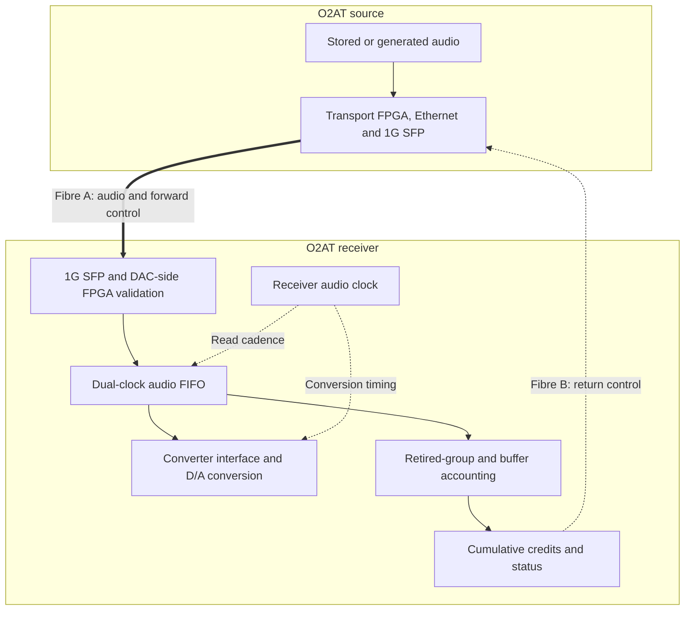

Caption: The mandatory baseline uses full-duplex 1G optical Ethernet. The receiver controls conversion timing and returns cumulative credits so the source sends within available storage.

Engineering note: The fibre isolates the audio-link path. Separate coaxial clock, power-earth, USB or analogue connections may provide conductive paths between chassis. The diagram is an architectural view, not a claim that an existing DAC accepts O2AT.

### 02. Common optical Ethernet link startup

File: `02_optical_link_startup.mmd`  
Website: /how-it-works/  
Status: Current v0.2 explanatory workflow  
Source: 4.1, 5.1, 5.3, 5.6

Separate physical link readiness from audio session readiness and clock acquisition.

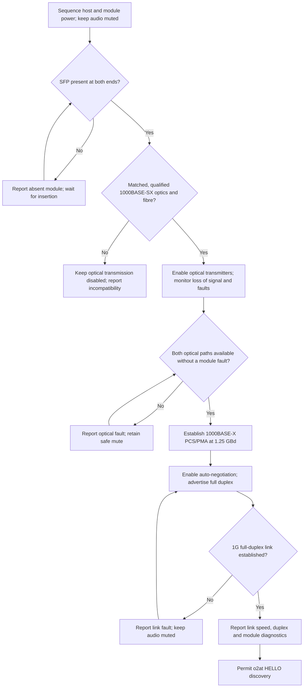

Caption: The mandatory baseline establishes a qualified 1000BASE-SX, full-duplex 1G Ethernet link before o2at discovery. Link-up alone does not permit playback.

Engineering note: This is the common packet/control workflow, not a newly standardised clock architecture. The diagram shows the common SX optical profile; explicitly qualified LX links and paired forced-operation tests are separate permitted cases. A 10 MHz input is not required for Ethernet link-up. A 10G-only host cannot be assumed to support a 1G SFP. The two directions are Ethernet directions, not an implied raw optical clock channel.

### 03. Common peer discovery and session negotiation

File: `03_discovery_and_negotiation.mmd`  
Website: /protocol/  
Status: Current v0.2 explanatory workflow  
Source: 4.1, 5.5, 5.6

Show the actual v0.2 control names, session admission, clock gate and ordering of START acknowledgement, prefill and playback.

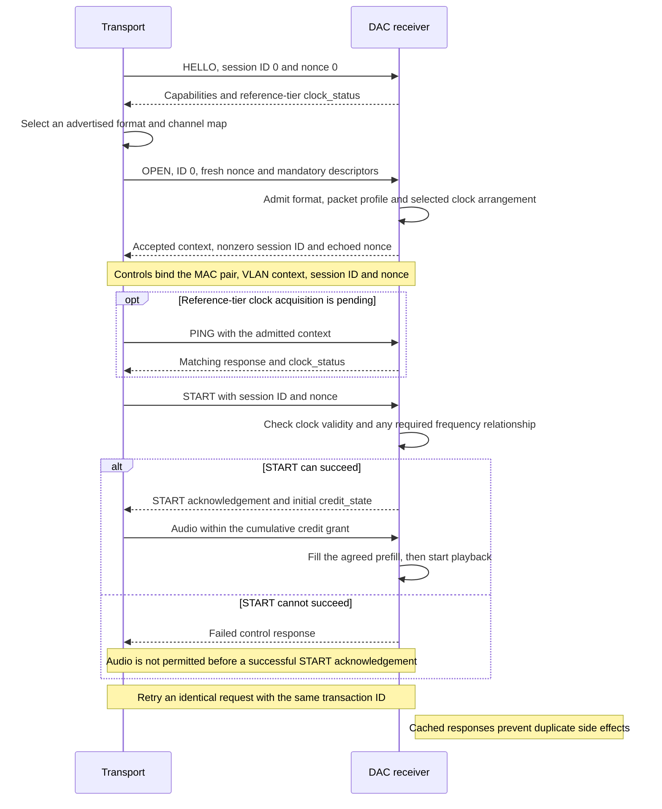

Caption: HELLO reports capabilities, OPEN fixes the admitted context, and START grants permission to send audio. The receiver begins playback only after the agreed prefill condition.

Engineering note: OPEN can prepare or acquire a clock; it does not certify that START can yet succeed. START requires a valid conversion clock and, in common-reference mode, an established frequency relationship. The selected clock arrangement must correspond to an admitted v0.2 clock_mode; proposed raw-clock return links require their own extension definition. Reference-tier successful HELLO, OPEN, START and PING responses include clock_status. Short streams can start below normal prefill only when their complete final range is buffered and FINAL_AUDIO agrees with END. An empty stream uses END with total_groups zero and no audio packet. Discovery broadcasts are bounded; established sessions use unicast.

### 04. Common format and forward-link capacity admission

File: `04_format_and_capacity_admission.mmd`  
Website: /tools/bandwidth/  
Status: Current v0.2 explanatory workflow  
Source: 4.1, 5.3, 5.5, 5.6, 5.8, 6.5

Expose packet overhead, whole-group alignment and endpoint admission independently of nominal optical serial rate.

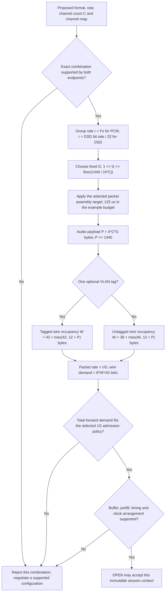

Caption: Compare the complete forward wire demand with 1.000 Gb/s MAC service. The 1.25 GBd optical line rate already includes the 1000BASE-X 8b/10b overhead.

Engineering note: W includes MAC addresses and EtherType, the optional four-byte VLAN tag, the 12-byte o2at header, minimum MAC padding, FCS, preamble/SFD and inter-frame gap. Do not apply 8b/10b overhead a second time. For the paper's 125 us assembly target, choose G no larger than min(floor(1440/(4*C)), max(1, floor(r*125e-6))). Negotiate a fixed smaller G when required. The paper uses an 85% planning ceiling for advanced direct links, including other forward traffic; it is not a universal guaranteed-latency claim. Reverse full-duplex control does not consume forward serial capacity. Buffer and clock feasibility remain separate admission requirements. Optional 10G fabric capability must be explicitly supported and admitted, not presumed.

### 05. Common PCM and native DSD packetisation

File: `05_pcm_and_dsd_packetisation.mmd`  
Website: /protocol/  
Status: Current v0.2 explanatory workflow  
Source: 4.2, 5.3, 5.4, 5.6, 5.7, 5.8

Make the difference between PCM samples and packed chronological DSD bits visible while preserving a single group and packet model.

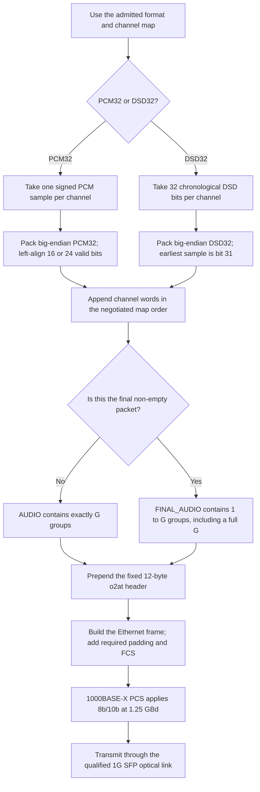

Caption: One PCM group contains one 32-bit container per channel. One DSD group contains 32 chronological one-bit samples per channel. Both use negotiated channel ordering and a fixed 12-byte o2at header.

Engineering note: PCM16 and PCM24 use zero-filled low padding bits inside the two's-complement PCM32 container. DSD32 is a bit container, not a signed sample or DoP word. Big-endian and MSB-first describe payload packing; they do not change IEEE Ethernet physical bit transmission or line coding. The earliest DSD bit is container bit 31. AUDIO always contains negotiated G groups. FINAL_AUDIO contains 1 to G, including a full G, and must agree with END. Empty streams have no audio packet. MAC minimum padding is outside the declared audio group count.

### 06. Common audio receive validation and fault containment

File: `06_receive_validation.mmd`  
Website: /protocol/  
Status: Current v0.2 explanatory workflow  
Source: 5.3, 5.4, 5.5, 5.6, 6.5, 7.1

Distinguish harmless foreign traffic from faults affecting an admitted audio timeline and prevent corrupt data reaching the conversion FIFO.

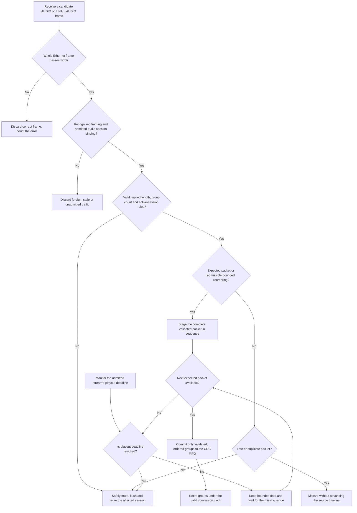

Caption: Complete-frame integrity and session checks precede FIFO commit. Unrelated traffic is discarded; a confirmed missing packet or invalid data threatening an active stream triggers that stream's protective mute and retirement.

Engineering note: This diagram covers AUDIO and FINAL_AUDIO. CONTROL additionally validates the source nonce and transaction semantics. The canonical audio binding is talker MAC, listener MAC, VLAN context and session ID. A corrupt Ethernet frame cannot reliably identify an o2at session, so a bad FCS alone does not immediately abort an arbitrary active stream; a subsequently confirmed gap can do so at its playout deadline. Reordering is bounded, the active window is below 32,768 packets, and frame residence must satisfy the sequence-unwrapping limit. The readiness decision is monitored over time; it faults only when the actual deadline is missed, not merely because a packet has not arrived yet. Output mute must use a safe converter-specific method, especially for DSD.

### 07. Common admitted-session lifecycle

File: `07_session_lifecycle.mmd`  
Website: /protocol/  
Status: Current v0.2 explanatory workflow  
Source: 5.5, 5.6, 6.5, 7.1

Summarise named v0.2 receiver phases, safe retirement and the requirement for a new binding on restart.

```mermaid
stateDiagram-v2
    accTitle: Common admitted-session lifecycle
    accDescr: An admitted context moves through preparation, prefill, playback and ordered draining; protection retires the session under safe mute.
    [*] --> IDLE
    IDLE --> OPEN: OPEN accepted with a fresh session binding
    OPEN --> OPEN: Clock acquisition or PING
    OPEN --> ARMED: START acknowledged with valid clock and initial credit
    ARMED --> RUNNING: Prefill complete or complete short-stream exception
    RUNNING --> RUNNING: Valid audio, CREDIT, PING or STATUS
    RUNNING --> DRAINING: Ordered final range is being retired
    DRAINING --> IDLE: Final range played and END agrees
    ARMED --> IDLE: END confirms an empty stream
    OPEN --> IDLE: ABORT, inactivity expiry, link loss or reset
    ARMED --> IDLE: ABORT, inactivity expiry or protection fault
    RUNNING --> IDLE: ABORT or protection fault
    DRAINING --> IDLE: ABORT or protection fault
    note right of ARMED
        Prefill starts only after START acknowledgement.
        END receipt does not discard in-flight audio.
    end note
    note right of DRAINING
        A played FINAL_AUDIO awaits missing END under mute.
        This drained FIFO is not an underrun.
    end note
    note left of IDLE
        Retire the old binding and retain reply caches.
        A restart requires a new nonce and session ID.
    end note
```

Caption: The named receiver phases separate admission, START acknowledgement, prefill, playback and draining. Every restart creates a new session rather than resetting counters inside the old one.

Engineering note: This is an explanatory phase diagram, not a complete normative event-transition table. The source prose does not fully tabulate state transitions for END arriving before prefill. END acceptance and final-range validation remain independent bookkeeping and must not bypass the prefill or complete-short-stream rule. A short stream starts only when its complete final range is buffered and FINAL_AUDIO plus END agree. An empty stream closes with END total_groups zero and no audio packet. OPEN and ARMED expire after two seconds without valid peer activity; running sessions abort after one second without valid peer traffic, while an audio deadline can act sooner. Loss of clock validity after START requires immediate safe mute and abort. Holdover retains a session only within declared clock and FIFO margins. STATUS does not authorise automatic resumption or a clock-mode change.

### 08. Common ordered finish and subsequent format change

File: `08_ordered_finish_and_format_change.mmd`  
Website: /protocol/  
Status: Current v0.2 explanatory workflow  
Source: 5.5, 5.6, 6.5, 7.1

Show both legal END and FINAL_AUDIO orderings without mistaking an END response for proof that playback has finished.

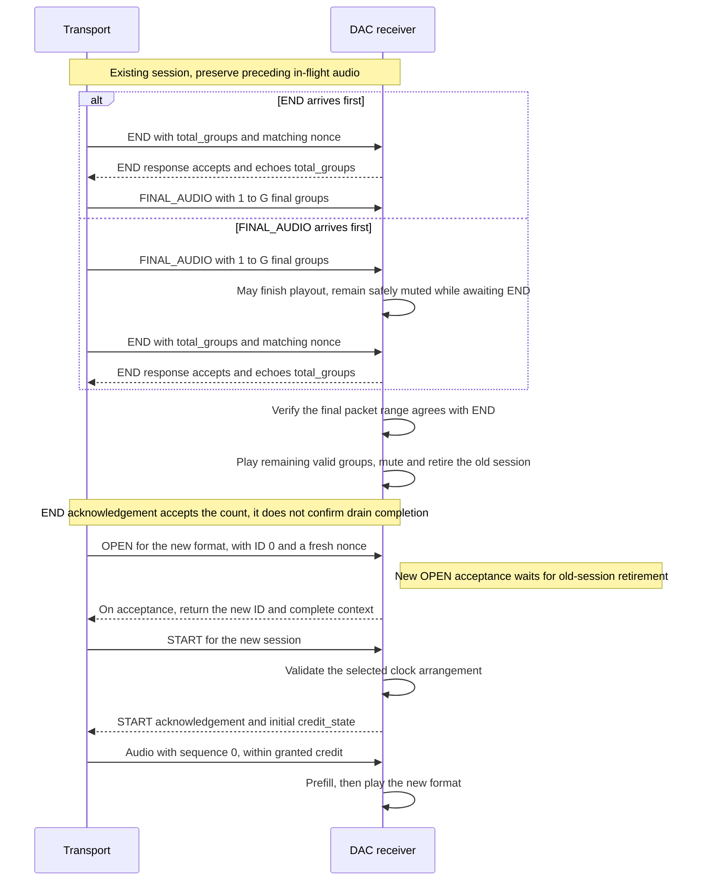

Caption: END accepts the exclusive final group count. The receiver preserves prior in-flight audio, verifies the final range and retires it before a different format can play under a new session.

Engineering note: The compact exchange shows successful completion of a non-empty stream. Short streams may satisfy prefill through complete-final-range agreement; empty streams use END total_groups zero without FINAL_AUDIO. A missing FINAL_AUDIO still follows the loss policy. After a validated FINAL_AUDIO has played, waiting under mute for END is not an underrun. END and ABORT reply caches survive retirement for at least the retry duration plus admitted frame residence. OPEN may report BUSY while the old session drains; a subsequent new attempt uses a new transaction ID, while a retransmission of the identical request keeps its original ID. ABORT is the separate mute, flush and retire path when discarding the old stream is intended. The new session begins audio sequence numbering at zero only after its own successful START acknowledgement.

### 09. Receiver ownership of conversion timing

File: `09_conversion_clock_ownership.mmd`  
Website: Clocking  
Status: Current v0.2 explanatory workflow  
Source: §6.1, §6.2, §6.3, §7.1

Separate serial clock recovery and transport-domain FIFO writes from receiver-owned audio-domain reads and D/A conversion.

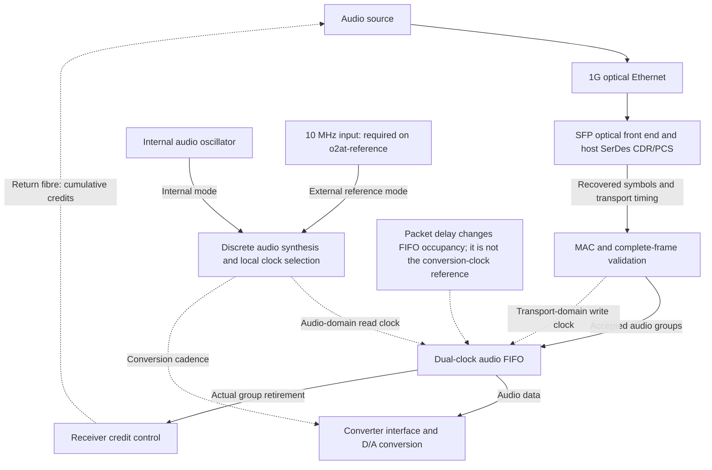

Caption: The optical receive path recovers transport symbols and validates complete frames. An independently engineered audio clock subsystem sets FIFO read timing and conversion cadence. Cumulative credits regulate delivery over the return fibre.

Engineering note: This is clock ownership, not a claim of zero jitter. Local supply coupling, clock-domain crossings and buffer faults still need validation. A 10 MHz input is mandatory on o2at-reference receivers, optional on o2at-basic, and does not discipline Ethernet or USB signalling clocks. The control arrow represents actual group retirement, not direct sampling of an unsafe cross-domain counter.

### 10. Clock preparation and the START acceptance gate

File: `10_clock_selection_and_start_gate.mmd`  
Website: Clocking  
Status: Current v0.2 explanatory workflow  
Source: §5.5, §5.6, §6.2, §6.3

Explain the difference between preparing a selected clock at OPEN and authorising audio at START.

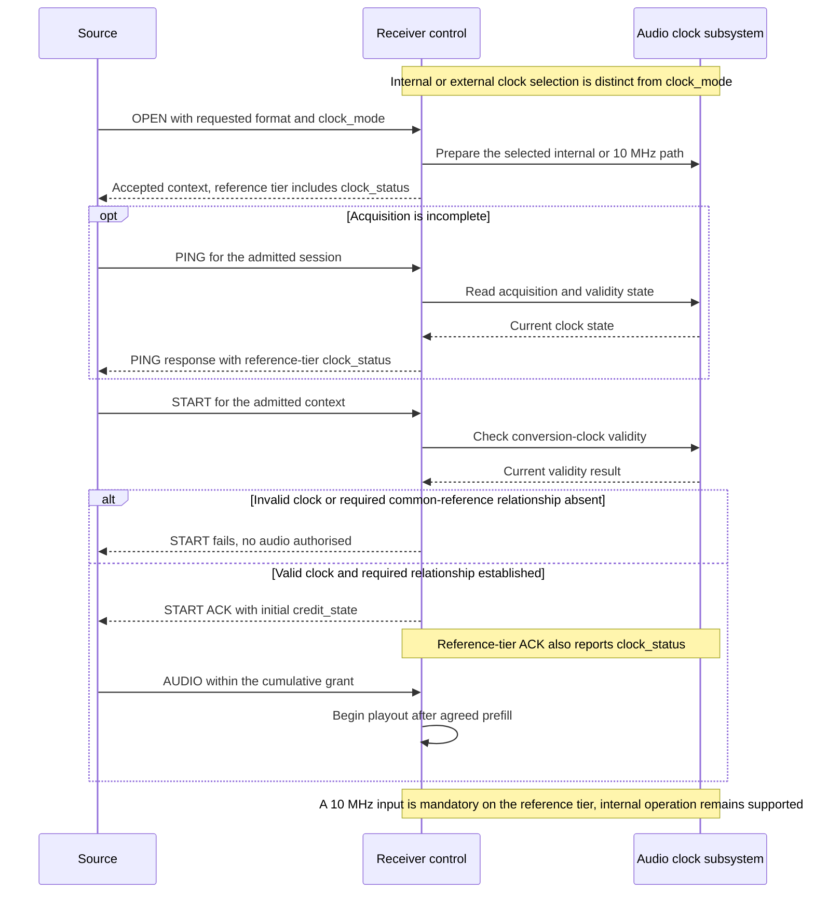

Caption: OPEN may acquire the selected clock, while PING can expose acquisition progress. START succeeds only with valid conversion timing and, in common-reference mode, an established frequency relationship. Audio follows the acknowledgement and respects the initial cumulative grant.

Engineering note: clock_mode declares receiver-paced or established common-reference operation; it does not itself define an internal/external clock-source selection command. The diagram assumes that source selection has been configured through an implementation-defined mechanism. Shared frequency does not establish a shared sample epoch or zero jitter. The short-stream exception to ordinary prefill is omitted: complete final audio plus matching END can permit earlier playout.

### 11. Finite holdover and local protection after reference loss

File: `11_reference_loss_and_holdover.mmd`  
Website: Clocking  
Status: Current v0.2 explanatory workflow  
Source: §5.5, §5.6, §6.3, §6.5, §6.6

Make clock validity, finite holdover and FIFO headroom simultaneous conditions for retaining a live session.

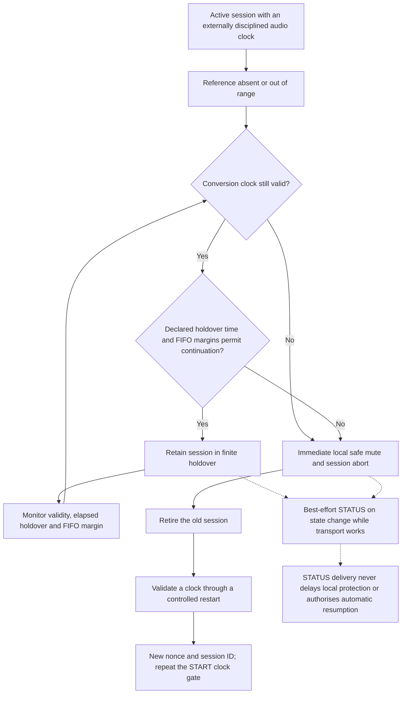

Caption: A reference failure can enter holdover only while conversion timing remains valid and the declared time and FIFO limits remain satisfied. Otherwise the receiver mutes and aborts locally. STATUS is best effort and never delays protection; recovery after abort uses a new session.

Engineering note: The source requires controlled clock transitions but does not specify a complete same-session relock state machine after a reference returns. This diagram deliberately covers bounded holdover and fault restart, without inventing automatic relock or a live clock-mode switch. Exact validity thresholds and holdover drift limits require a documented, measured clock implementation.

### 12. Three source rate-control cases

File: `12_source_rate_control_cases.mmd`  
Website: Clocking  
Status: Current v0.2 explanatory workflow  
Source: §5.6, §6.4, §6.5

Distinguish elastic playback, frequency-coherent live production and an independent unpausable live source.

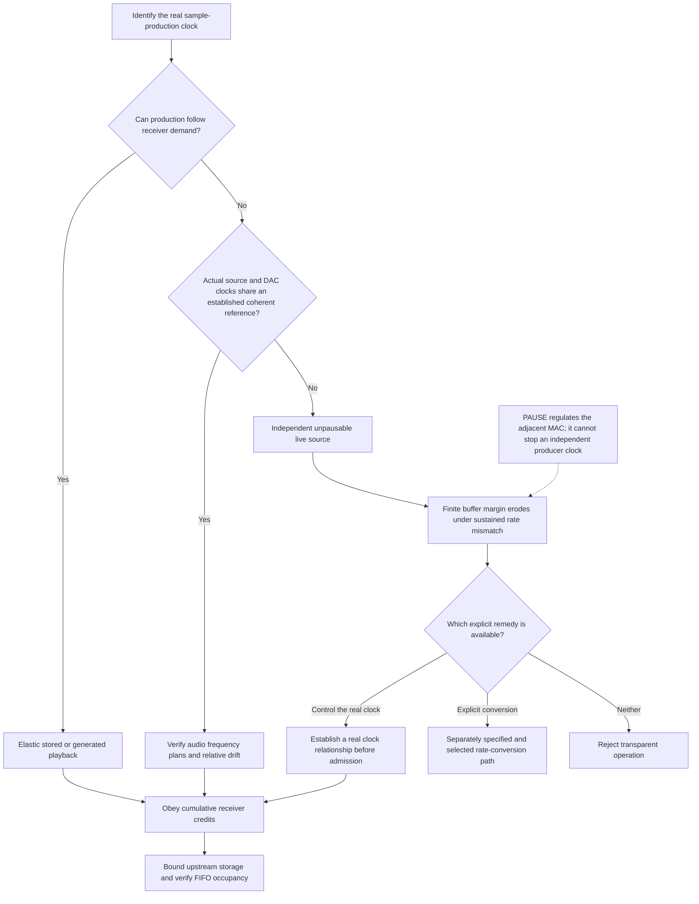

Caption: Receiver credits regulate link delivery in every admitted mode. They can pace an elastic producer, but an independent fixed-rate live source needs a real clock relationship or explicitly selected conversion. A finite FIFO cannot absorb sustained rate mismatch indefinitely.

Engineering note: The conversion branch identifies a possible system remedy, not a rate-conversion algorithm or profile implemented by v0.2. Shared-reference operation still needs bounded burst and FIFO accounting, and shared frequency does not define the sample epoch. IEEE 802.3x PAUSE is supplementary adjacent-link control, not an end-to-end producer-rate servo.

### 13. Cumulative receiver credits and actual consumption

File: `13_cumulative_credit_flow.mmd`  
Website: Protocol and reliability  
Status: Current v0.2 explanatory workflow  
Source: §5.5, §5.6, §6.5

Show the exclusive cumulative send limit and why repeated CREDIT messages do not multiply available storage.

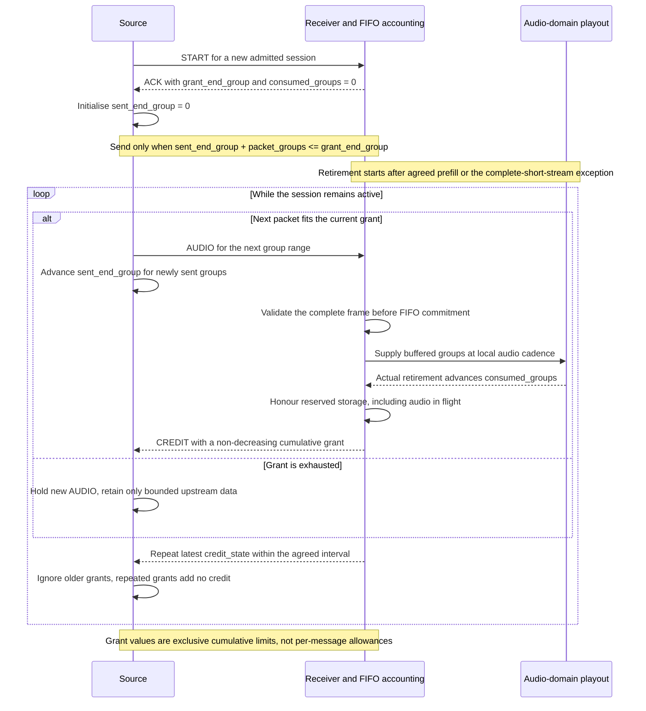

Caption: The source may send only when sent_end_group + packet_groups <= grant_end_group. The receiver honours already granted space, including groups in flight, and updates consumed_groups from actual audio-side retirement. Grants cannot be retracted; repeated and older notifications do not create extra credit.

Engineering note: The diagram abstracts control/session validation and the clock gate, which must already have passed. It does not prescribe a new numerical grant formula. Credit accounting must include validated storage, current occupancy and outstanding data; the latest cumulative grant is repeated within the negotiated interval. Clock-domain transfer of retirement counters needs a coherent implementation.

### 14. A packet gap retains its original playout deadline

File: `14_packet_gap_and_playout_deadline.mmd`  
Website: Protocol and reliability  
Status: Current v0.2 explanatory workflow  
Source: §5.6, §6.5, §7.1

Show how an optional bounded reorder buffer differs from timeline compression or indefinite waiting.

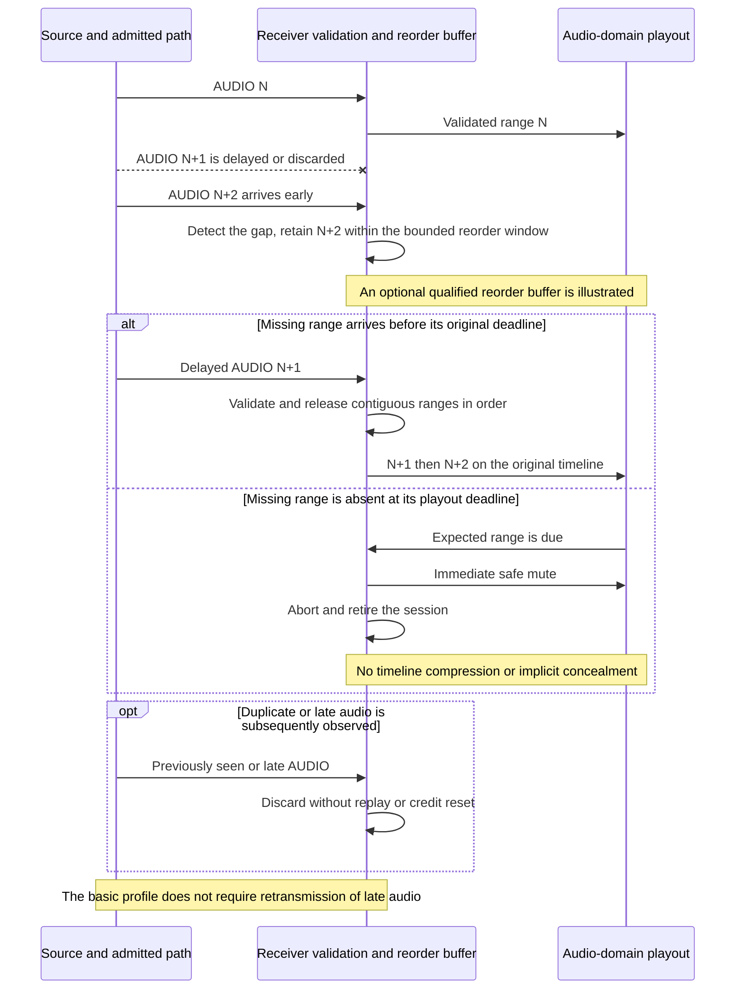

Caption: A later packet can wait in a qualified bounded reorder buffer while an earlier range is missing. If that range misses its original playout deadline, the basic profile safely mutes and aborts. Duplicate and late audio is discarded without replaying samples or closing the timing gap.

Engineering note: Reordering support is optional and must fit the admitted window. The successful branch represents delayed delivery, not mandatory audio retransmission. Concealment would need a future explicitly negotiated policy. Safe DSD protection means converter mute or a validated idle/transition sequence, not blindly substituting all-zero bits.

### 15. Proposed asynchronous USB audio to o2at feedback bridge

File: `15_usb_audio_feedback_bridge.mmd`  
Website: Implementation and bridges  
Status: Proposed bridge derived from v0.2  
Source: §5.5, §5.6, §6.1, §6.4, §7.3, §7.4

Connect receiver consumption and cumulative credits to a genuine USB audio feedback controller without conflating audio delivery and bus timing.

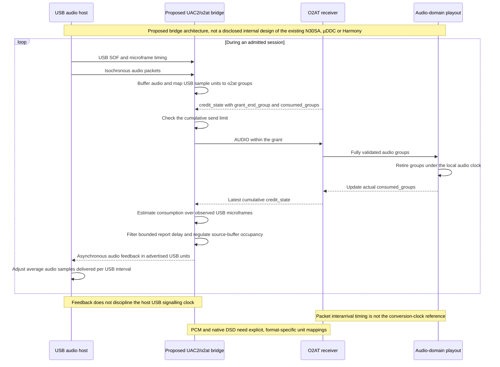

Caption: A proposed bridge compares downstream cumulative group consumption with its observed USB microframe count, filters bounded reporting variation and regulates source-buffer occupancy. Feedback changes the host's average sample delivery while the receiver retains conversion-clock authority.

Engineering note: This is a proposed bridge, not a documented internal schematic of the N30SA, existing LAiV µDDC or Harmony DAC. The µDDC relationship between external reference and USB feedback remains undocumented in the reviewed public specifications. PCM and vendor-specific native DSD require explicit USB-unit mappings, endpoint/driver qualification and loop-stability tests. O2AT capacity does not prove that USB ingress or the DAC egress supports the same extreme formats.

### 16. Admission decision for a proposed legacy PCM input bridge

File: `16_legacy_input_clock_decision.mmd`  
Website: Implementation and bridges  
Status: Proposed bridge derived from v0.2  
Source: §4.3, §5.6, §6.4, §6.5

Expose the live-clock condition required for a transparent legacy-input bridge and mark future ADAT and source-clock-tracking work as conditional.

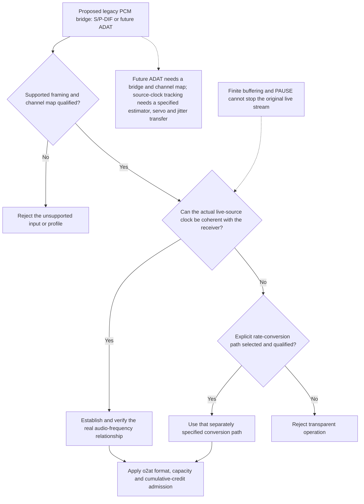

Caption: Legacy live inputs continue at their originating device's rate and cannot consume o2at credits. A proposed bridge must qualify framing and channel order, then establish a real coherent audio-clock relationship or use an explicitly selected conversion path before normal O2AT admission.

Engineering note: This is a conditional design decision, not an implemented ADAT, S/MUX or source-clock-tracking profile. The PCM scope does not add an opaque compressed-audio transport. A future tracking profile needs its own estimator, servo and jitter-transfer specification; it must not connect the recovered optical serial clock directly to D/A conversion. Buffering and PAUSE alone cannot stabilise an independent unpausable source.

### 17. Direct and switched topologies

File: `17_direct_and_switched_topology.mmd`  
Website: How it works  
Status: Current v0.2 explanatory workflow  
Source: 4.1, 4.2, 5.1, 5.3, 5.6, 6.4, 7.2

Contrast the mandatory direct 1G connection with an optional qualified Ethernet fabric, while distinguishing end-to-end credits from hop-local PAUSE.

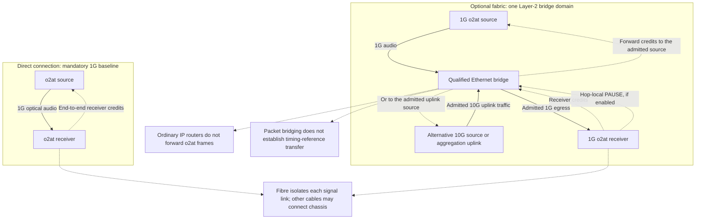

Caption: The consumer baseline uses a direct 1G optical connection. An optional fabric can bridge admitted traffic from 1G ports or 10G aggregation within one Layer-2 domain. Receiver credits reach the appropriate source; PAUSE applies only to an adjacent MAC. Packet-switch qualification does not establish transparent timing-reference transfer.

Engineering note: The two source paths illustrate alternatives or admitted sessions, not unrestricted simultaneous streams to one receiver. A bridge is not an IP router. Fibre isolation applies to the signal link; clock coax and other cables may provide parallel conductive paths. Switch configuration and mixed-speed burst limits require qualification. Ordinary switch retiming breaks an assumed PHY-derived DAC frequency reference unless a separately qualified clock-aware mechanism exists. A proposed dedicated return-clock path may bypass the data switch. Integrated or split timing-transfer extensions are not yet specified by v0.2.

### 18. Switched-path admission

File: `18_switched_path_admission.mmd`  
Website: How it works  
Status: Current v0.2 explanatory workflow  
Source: 5.3, 5.6, 5.8, 6.5, 7.2

Show why aggregate bandwidth arithmetic alone is insufficient to admit a switched or mixed-speed path.

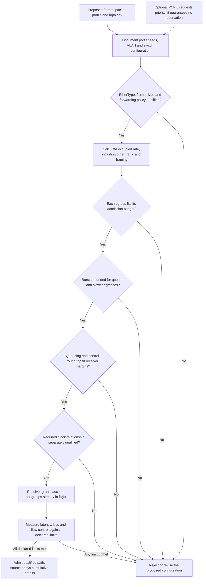

Caption: Admission evaluates the actual forwarding policy, every egress budget, queue exposure to bursts, and the control round trip. Receiver credits remain end-to-end, while intermediate queues also need bounded traffic. Qualify the required clock relationship independently of packet admission.

Engineering note: PCP 6 is an optional scheduling request, not a reservation or a latency guarantee. The direct-link 85% ceiling does not supply a universal switched-path ceiling. This diagram organises engineering checks rather than defining a new admission message exchange. An ordinary packet switch does not preserve an assumed DAC-originated PHY frequency reference. A clock-aware path or dedicated clock route needs its own specification and validation; proposed clock-transfer extensions are outside the present v0.2 definition.

### 19. Validated frame commit and clock-domain crossing

File: `19_clock_domain_crossing.mmd`  
Website: Build and test  
Status: Current v0.2 explanatory workflow  
Source: 5.6, 6.1, 6.5, 7.1

Locate full-frame validation ahead of playback and show the separation between recovered link timing and conversion timing.

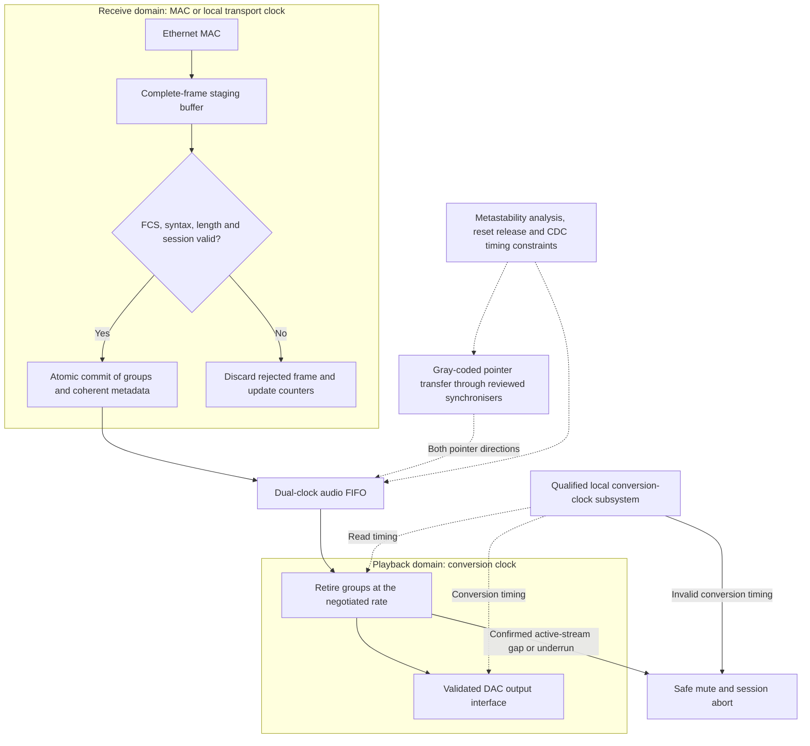

Caption: The illustrated implementation stages each complete frame, checks FCS and protocol validity, then commits coherent audio groups to a dual-clock FIFO. A qualified conversion-clock subsystem controls group retirement and the converter interface. Pointer transfer, reset release and CDC timing still require review.

Engineering note: Complete-frame staging is one permitted implementation; an atomic rollback design is acceptable only if corrupt groups can never become visible to playback. Rejected foreign traffic does not itself mute an unrelated session. Output protection follows confirmed active-stream faults. No FIFO or FPGA PLL eliminates oscillator phase noise or local coupling.

### 20. Receiver power and RF partitioning

File: `20_receiver_power_and_rf_partitioning.mmd`  
Website: Build and test  
Status: Current v0.2 explanatory workflow  
Source: 4.2, 5.1, 5.2, 6.3, 7.1

Explain the local engineering work that remains after the optical signal link provides galvanic isolation.

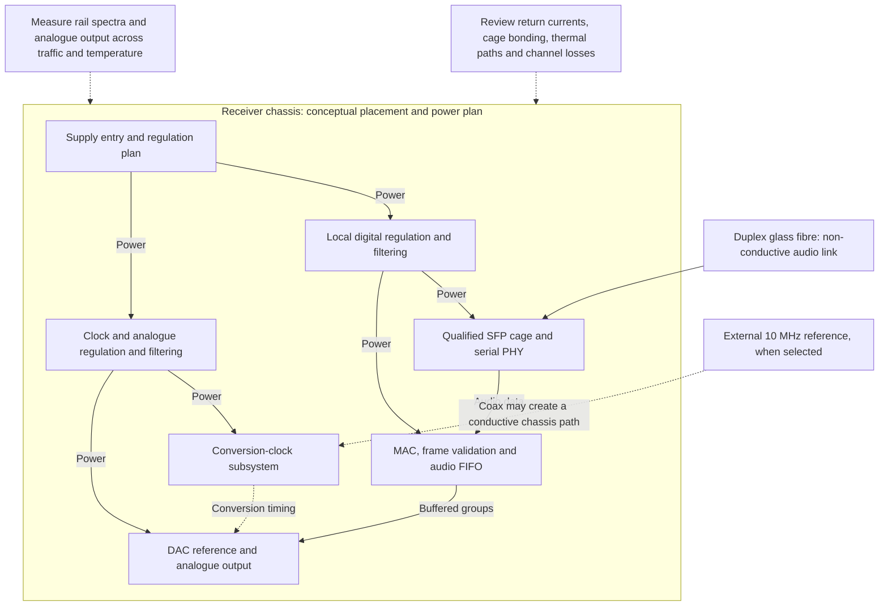

Caption: Separate the placement and power-integrity analysis of the optical and digital circuitry from the sensitive clock and analogue paths. Validate the actual module, return-current structure, thermal design and measured coupling. A shared reference-clock coax may electrically reconnect chassis.

Engineering note: This is a conceptual block partition, not an analogue schematic or a prescription to split ground planes, remove safety earth or require separate power supplies. Arrows labelled power identify functional supply paths, not galvanic barriers. Neither 1G operation nor a non-retimed module guarantees a particular analogue result.

### 21. Link, session and clock diagnostics

File: `21_user_diagnostics.mmd`  
Website: How it works  
Status: Current v0.2 explanatory workflow  
Source: 5.1, 5.6, 6.5, 8

Translate the draft diagnostic requirements into distinct user-visible outcomes and useful engineering counters.

```mermaid
flowchart TD
    accTitle: Separate link, session and clock diagnostics
    accDescr: The user interface reports physical link, admitted session and conversion-clock state separately. Local output protection acts independently of status delivery. Engineering counters explain faults without hiding an unsupported format behind a link indicator.
    device["o2at device status"]
    link["Link: module, loss of signal, speed and duplex"]
    session["Session: capabilities, accepted format and current state"]
    clock["Clock: internal, locked, declared holdover or invalid"]
    physical["Physical fault: identify the optical or link problem"]
    unsupported["Unsupported mode: refuse admission and explain why"]
    protect["Invalid timing or exhausted safe holdover: mute and abort"]
    display["Present distinct link, session and clock outcomes"]
    format["Show verified PCM rate, DSD family and channel count"]
    latency["Show packet deadline, FIFO target and qualified topology"]
    counters["Expose FCS, sequence, syntax, FIFO and restart counters"]
    local["Local protection does not wait for status delivery"]
    device --> link
    device --> session
    device --> clock
    link -->|"On fault"| physical
    session -->|"On failed admission"| unsupported
    clock -->|"On unsafe timing"| protect
    link --> display
    session --> display
    clock --> display
    counters --> display
    display --> format
    display --> latency
    local -.-> protect
```

Caption: A physical link, an admitted audio session and valid conversion timing are separate states. Present all three clearly, show only verified format capabilities, and expose counters and the qualified latency configuration when diagnosing a fault.

Engineering note: Display updates and best-effort STATUS delivery must never delay local safe mute or abort. Declared holdover is valid only within its clock and FIFO bounds. Diagnostic access may be local or optional; a management application is not required for basic direct playback.

### 22. Proposed prototype validation workflow

File: `22_prototype_validation_workflow.mmd`  
Website: Build and test  
Status: Proposed editorial or release workflow  
Source: 7.2, 7.3, 9.2, 9.4

Organise the paper's validation programme into a reproducible engineering workflow suitable for the build page.

```mermaid
flowchart TD
    accTitle: Proposed prototype validation workflow
    accDescr: This editorial workflow organises the draft validation programme. It is not a normative protocol message sequence and does not claim that a working prototype or completed measurements already exist.
    proposal["Editorial workflow recommendation: prototype validation"]
    scope["Freeze draft version, test scope and acceptance criteria"]
    vectors["Publish exact PCM, DSD and protocol test vectors"]
    simulation["Exercise control, credits and fault handling in simulation"]
    implementation["Implement a native generator and receiver path"]
    link["Qualify optics, temperature, loss and sustained traffic"]
    clock["Measure both clock families, FIFO behaviour and conversion timing"]
    fault["Inject corruption, gaps, stale frames and reference loss"]
    interop["Test independent sources and receivers"]
    review{"Evidence meets the declared acceptance criteria?"}
    repair["Record defects and rerun affected tests after correction"]
    publish["Publish reproducible builds, traces, results and limits"]
    proposal --> scope
    scope --> vectors
    vectors --> simulation
    simulation --> implementation
    implementation --> link
    link --> clock
    clock --> fault
    fault --> interop
    interop --> review
    review -->|"No"| repair
    repair --> simulation
    review -->|"Yes"| publish
```

Caption: Editorial workflow recommendation, not a normative protocol message sequence. Establish test vectors and acceptance criteria, implement the path, measure it, inject faults and publish reproducible evidence with its limitations.

Engineering note: The order is a recommended project workflow, not an additional conformance requirement. It makes no claim that a working O2AT prototype, independent peer review or completed performance measurements exist. Extreme-rate transport tests do not establish that an existing USB source or DAC supports those rates.

### 23. Proposed interoperability and release gates

File: `23_interoperability_release_gates.mmd`  
Website: Build and test  
Status: Proposed editorial or release workflow  
Source: 5.3, 9.2, 9.3, 9.4

Keep publication and conformance claims tied to independent implementations, qualified parts and safe failure behaviour.

```mermaid
flowchart TD
    accTitle: Proposed interoperability and release gates
    accDescr: This editorial release workflow derives from the draft validation and governance programme. Independent interoperability, qualified optics, safe failure behaviour and a production identifier are evidence gates, not claims of existing certification or endorsement.
    proposal["Editorial workflow recommendation: release gates"]
    definitions["Freeze packet and control definitions for review"]
    independent{"Two independent sources and two receivers interoperate?"}
    optics{"Baseline optical parts qualified?"}
    safety{"No unresolved safety-of-output failures?"}
    fabric{"Fabric capability claimed?"}
    switches{"Documented switch configuration validated?"}
    clock_extension{"Proposed clock-transfer extension claimed?"}
    clock_path{"Reference transfer specified and independently qualified?"}
    identifier{"Production protocol identifier available?"}
    draft["Remain an engineering draft and record missing evidence"]
    evaluation["Controlled experimental evaluation only"]
    release["Publish versioned release, conformance scope and evidence"]
    proposal --> definitions
    definitions --> independent
    independent -->|"Yes"| optics
    independent -->|"No"| draft
    optics -->|"Yes"| safety
    optics -->|"No"| draft
    safety -->|"Yes"| fabric
    safety -->|"No"| draft
    fabric -->|"Yes"| switches
    fabric -->|"No"| clock_extension
    switches -->|"Yes"| clock_extension
    switches -->|"No"| draft
    clock_extension -->|"Yes"| clock_path
    clock_extension -->|"No"| identifier
    clock_path -->|"Yes"| identifier
    clock_path -->|"No"| draft
    identifier -->|"Yes"| release
    identifier -->|"No"| evaluation
```

Caption: Editorial workflow recommendation, not a normative protocol message sequence. The proposed programme requires independent interoperability evidence, qualified baseline optics and resolved output-safety failures. Fabric claims require a documented switched configuration, and public commercial deployment needs a proper protocol identifier. Any proposed clock-transfer extension also needs an explicit timing specification and independent path qualification.

Engineering note: The two-source and two-receiver criterion follows the measurable validation programme in section 9.2. EtherType 0x88B5 remains experimental. Passing these project gates does not confer external standards approval, legal clearance or manufacturer endorsement, and the governance process remains proposed. The conditional clock-transfer gate is an editorial extension of the release programme, not a requirement already defined in v0.2. Packet interoperability alone does not establish timing-reference continuity through switches, and a dedicated clock path may bypass them.

### 24. Proposed contribution and change control

File: `24_contribution_and_change_control.mmd`  
Website: Contribute  
Status: Proposed editorial or release workflow  
Source: 4.2, 9.3, 9.4

Provide an actionable public review route that preserves source traceability, compatibility reasoning and versioned decisions.

```mermaid
flowchart TD
    accTitle: Proposed contribution and change-control workflow
    accDescr: This editorial governance recommendation records evidence, compatibility review and public decisions. It is not a normative wire-protocol sequence or a claim that a governing organisation or adopted licence policy already exists.
    proposal["Editorial workflow recommendation: contribution review"]
    submission["Submit version, section, evidence and proposed change"]
    triage["Check scope, duplication and reproducibility"]
    impact{"Normative behaviour or capability affected?"}
    editorial["Trace editorial corrections to the source"]
    compatibility["Assess wire version, negotiation and compatibility"]
    review["Public engineering review with relevant test evidence"]
    licences["Check proposed licences and third-party obligations"]
    decision{"Accept the change?"}
    revise["Record rationale and request missing evidence"]
    update["Update specification, registry and conformance vectors as affected"]
    publish["Publish versioned changes and errata with the decision"]
    retain["Retain previous releases and public decision history"]
    proposal --> submission
    submission --> triage
    triage --> impact
    impact -->|"No"| editorial
    impact -->|"Yes"| compatibility
    editorial --> review
    compatibility --> review
    review --> licences
    licences --> decision
    decision -->|"Yes"| update
    decision -->|"Further evidence needed"| revise
    revise --> review
    decision -->|"Reject with public rationale"| retain
    update --> publish
    publish --> retain
```

Caption: Editorial workflow recommendation, not a normative protocol message sequence. Contributions identify the affected draft and evidence, receive compatibility and licence review, and lead to a recorded decision. Accepted changes update the relevant specification, registry, tests and release history.

Engineering note: The submission fields and review ordering are website governance recommendations derived from the paper, not adopted policy or evidence that a formal governing organisation exists. Proposed open licences and third-party obligations must remain distinct; no licence is presented as patent clearance or certification.

### 25. Type 1: integrated audio and forward frequency reference

File: `25_type1_integrated_forward_reference.mmd`  
Website: Clocking / Proposed architectures  
Status: Proposed optical clock-transfer extension  
Source: Proposed extension, WP 6.1-6.3, E01

Show the requested single-connection option with an explicitly source-owned audio reference.

```mermaid
flowchart TD
    accTitle: Type 1 proposed integrated audio and frequency-reference link
    accDescr: A source master clock governs audio production and a qualified Ethernet transmit reference. The DAC recovers the line frequency, disciplines its local audio oscillator, and converts buffered audio. Return Ethernet control remains present.
    subgraph transport["Transport: source-master option"]
        MASTER["Source audio master"] -. "Audio cadence" .-> PRODUCE["Transport FPGA: stereo production"]
        MASTER -. "Defined frequency ratio" .-> LINE["Qualified Ethernet clock generator"]
        PRODUCE --> TX["FPGA MAC, PHY and 1G SFP"]
        LINE -. "Transmit timing" .-> TX
    end
    subgraph receiver["DAC: reference-following option"]
        RX["SFP and host SerDes CDR / PCS"] --> VALID["DAC FPGA: frame validation"]
        VALID --> FIFO["Audio FIFO"]
        RX -. "Recovered frequency" .-> CLEAN["Qualified local oscillator discipline"]
        CLEAN -. "Local conversion clock" .-> CONVERT["Stereo D/A conversion"]
        CLEAN -. "FIFO read cadence" .-> FIFO
        FIFO --> CONVERT
        FIFO --> CREDIT["Receiver credit accounting"]
    end
    TX ==>|"Forward fibre: stereo data and line reference"| RX
    CREDIT -. "Return fibre: Ethernet control" .-> TX
```

Caption: Proposed Type 1: the transport's audio master has a defined relationship to the continuous forward optical line. The DAC disciplines a local audio oscillator from the recovered reference, then reads the FIFO and performs conversion with that local clock. The ordinary return control path remains present.

Engineering note: One pipe here means one logical duplex connection, not a claim that all traffic travels in one physical fibre. This frequency-transfer mechanism is not defined by v0.2. Directly connecting a raw CDR output to the converter is not proposed. Clock ratios, noise transfer, holdover and capability signalling require specification and qualification. The nominal Ethernet rate remains fixed; a sample-rate change alters the declared synthesis/divider relationship, not the Ethernet link speed.

### 26. Type 2: DAC-master timing returned to the transport

File: `26_type2_dac_master_concept.mmd`  
Website: Home / Clocking / Proposed architectures  
Status: Proposed optical clock-transfer extension  
Source: Proposed extension, WP 5.6, WP 6.1-6.5

Express the requested separation of forward stereo data and upstream timing authority.

```mermaid
flowchart TD
    accTitle: Type 2 proposed DAC-master data and timing pipes
    accDescr: The DAC clock directly governs conversion and originates an upstream optical timing reference. The transport follows that reference for audio production, sends both stereo channels together, and still obeys receiver credits.
    subgraph dac["DAC: timing authority"]
        MASTER["DAC audio master"] -. "Conversion cadence" .-> CONVERT["Stereo D/A conversion"]
        MASTER -. "Defined ratio" .-> TIMETX["Optical timing transmitter"]
        RECEIVE["DAC FPGA: data validation"] --> FIFO["Audio FIFO"]
        MASTER -. "FIFO read cadence" .-> FIFO
        FIFO --> CONVERT
        FIFO --> CREDIT["Buffer and credit accounting"]
    end
    subgraph transport["Transport: timing follower"]
        TIMERX["Optical timing receiver"] --> CLEAN["Qualified reference recovery and discipline"]
        CLEAN -. "Audio production cadence" .-> PRODUCE["Transport FPGA: stereo production"]
        PRODUCE --> TRANSMIT["Packetiser and optical data transmitter"]
    end
    TIMETX ==>|"Pipe 2: DAC-originated timing"| TIMERX
    TRANSMIT ==>|"Pipe 1: left and right together"| RECEIVE
    CREDIT -. "CREDIT and STATUS on specified return carriage" .-> TRANSMIT
```

Caption: Proposed Type 2: the DAC clock governs local FIFO reads and conversion, and sends a reference upstream. The transport follows that reference for audio production and sends both stereo channels together within the receiver's cumulative credit grant.

Engineering note: This is a logical architecture. The dotted control arrow does not imply a third physical fibre: its carriage must be defined by the chosen implementation, as illustrated in diagrams 27 and 28. Frequency coherence does not establish a shared sample epoch, eliminate all jitter or remove finite-buffer protection. No new wire-profile identifier is allocated here.

### 27. Type 2 candidate A: frequency transfer over the reverse Ethernet line

File: `27_type2_duplex_ethernet_frequency_candidate.mmd`  
Website: Clocking / Build and test  
Status: Proposed optical clock-transfer extension  
Source: Proposed extension, WP 5.1, WP 5.6, WP 6.1, E01, E02

Show how one SFP module at each end and one duplex LC pair might support the requested directional roles while preserving Ethernet control.

```mermaid
flowchart TD
    accTitle: Type 2 candidate using the two fibres of one duplex Ethernet link
    accDescr: The DAC derives a compliant reverse Ethernet line clock from its audio reference. The transport extracts that continuous physical-layer frequency before elasticity, cleans it and disciplines audio production. Normal reverse control frames remain intact.
    subgraph dac["DAC: one SFP module"]
        MASTER["DAC audio master"] -. "Local cadence" .-> CONVERT["D/A conversion"]
        MASTER -. "Qualified ratio" .-> TXCLOCK["Ethernet transmit clock generator"]
        TXCLOCK -. "Continuous line timing" .-> REVERSE["DAC FPGA: return MAC / PCS and SFP TX"]
        RECEIVE["SFP RX and DAC FPGA validation"] --> FIFO["Audio FIFO"]
        MASTER -. "FIFO read cadence" .-> FIFO
        FIFO --> CONVERT
        FIFO --> CONTROL["CREDIT and STATUS"]
        CONTROL --> REVERSE
    end
    subgraph transport["Transport: one SFP module"]
        RECOVER["SFP RX and host SerDes CDR"] -. "Recovered reference before elasticity" .-> CLEAN["Qualified clock-cleaning subsystem"]
        RECOVER --> MAC["Transport FPGA: return control"]
        CLEAN -. "Audio cadence" .-> PRODUCE["Transport FPGA: stereo production"]
        PRODUCE --> FORWARD["Packetiser, MAC / PCS and SFP TX"]
        MAC -. "Cumulative grant" .-> FORWARD
    end
    REVERSE ==>|"Fibre B: encoded line timing plus control"| RECOVER
    FORWARD ==>|"Fibre A: framed stereo audio"| RECEIVE
```

Caption: Candidate A retains valid 1000BASE-X signalling in both directions. The DAC's reverse transmitter follows a qualified frequency relationship to its audio clock. The transport extracts the continuous line reference before any elasticity that would replace it with a local clock, cleans it and disciplines audio production. Reverse control frames continue normally.

Engineering note: The reverse fibre is not an unmodulated raw-clock wire: it carries an encoded Ethernet line with control traffic and idle symbols, and clock recovery remains necessary. Preserve Ethernet tolerances, auto-negotiation and link fault behaviour. Use a direct path or separately qualified frequency-aware topology. This diagram does not assert SyncE compliance, a completed clock plan or a measured implementation. Never feed the forward recovered reference back into the DAC master loop. The nominal Ethernet rate remains fixed; a sample-rate change alters the declared synthesis/divider relationship, not the Ethernet link speed.

### 28. Type 2 candidate B: a genuinely separate optical reference link

File: `28_type2_separate_optical_reference_link.mmd`  
Website: Clocking / Build and test  
Status: Proposed optical clock-transfer extension  
Source: Proposed extension, WP 5.1, WP 5.6, WP 6.3, E03

Keep the timing path separate from the ordinary duplex Ethernet data and control connection.

```mermaid
flowchart TD
    accTitle: Type 2 candidate with a separate optical reference link
    accDescr: Ordinary duplex Ethernet carries audio and return control. An additional optical timing path carries the DAC reference directly to the transport and bypasses the packet switch. This requires additional optical hardware.
    subgraph dac["DAC end"]
        MASTER["DAC audio master"] -. "Conversion cadence" .-> PLAY["Audio FIFO and conversion"]
        MASTER -. "Specified reference format" .-> CLOCKTX["Qualified optical clock transmitter"]
        RX["DAC FPGA and data-link SFP"] --> PLAY
        PLAY -. "Credits and status" .-> RX
    end
    subgraph transport["Transport end"]
        CLOCKRX["Qualified optical clock receiver"] --> DISCIPLINE["Local clock discipline"]
        DISCIPLINE -. "Audio cadence" .-> PRODUCE["Transport FPGA: stereo production"]
        PRODUCE --> TX["Packetiser and data-link SFP"]
    end
    CLOCKTX ==>|"Additional timing path"| CLOCKRX
    TX ==>|"Audio"| PATH["Direct or qualified Layer-2 data path"]
    PATH ==>|"Audio"| RX
    RX -. "Ethernet control" .-> PATH
    PATH -. "Ethernet control" .-> TX
```

Caption: Candidate B keeps the existing duplex data link intact and adds a dedicated DAC-to-transport optical reference path. The reference can bypass the packet switch. The data link continues carrying stereo audio in one direction and receiver control in the other.

Engineering note: This requires additional optical hardware and fibre unless a separately specified multiplexing scheme is introduced. The clock channel needs its own waveform or encoding, optical and electrical limits, rate range, duty-cycle behaviour, acquisition, loss detection and jitter budget. An ordinary SFP data sheet does not automatically qualify raw 10 MHz, word-clock or I2S transmission.

### 29. Proposed Type 2 acquisition, holdover and fault workflow

File: `29_type2_acquisition_and_fault_workflow.mmd`  
Website: Clocking / Build and test  
Status: Proposed optical clock-transfer extension  
Source: Proposed extension workflow, WP 5.6, WP 6.3-6.5

Identify the readiness and protection conditions the new DAC-master extension must define.

```mermaid
flowchart TD
    accTitle: Proposed Type 2 acquisition and fault workflow
    accDescr: The DAC is the sole timing authority. Audio starts only after DAC timing, returned-reference recovery and transport discipline are valid. Both endpoints retain finite-buffer protection, bounded holdover and a new-session restart rule.
    SELECT["Select the proposed DAC-master profile"] --> DACOK{"DAC conversion clock valid?"}
    DACOK -->|"No"| WAIT["Remain muted and report acquisition"]
    WAIT --> DACOK
    DACOK -->|"Yes"| RETURN["Establish the optical return reference"]
    RETURN --> SOURCEOK{"Transport reference and ratio valid?"}
    SOURCEOK -->|"No"| WAITREF["Hold audio transmission and diagnose"]
    WAITREF --> RETURN
    SOURCEOK -->|"Yes"| ADMIT["Validate profile readiness and session context"]
    ADMIT --> START["START acknowledgement and initial credits"]
    START --> PREFILL["Send within grant and complete prefill"]
    PREFILL --> RUN["Convert at DAC cadence and monitor both ends"]
    RUN --> HEALTH{"Clock and buffer bounds valid?"}
    HEALTH -->|"Yes"| RUN
    HEALTH -->|"Reference disturbance"| HOLD{"Declared valid holdover remains?"}
    HOLD -->|"Yes"| BOUNDED["Continue only within clock and FIFO bounds"]
    BOUNDED --> HEALTH
    HOLD -->|"No"| PROTECT["Immediate local mute or source stop and abort"]
    HEALTH -->|"Invalid timing or exhausted buffer"| PROTECT
    PROTECT --> REPORT["Attempt fault notification using the active binding"]
    REPORT -->|"Do not wait for delivery"| RESTART["Retire, reacquire and negotiate a new session"]
    RESTART --> DACOK
```

Caption: The proposed extension establishes one DAC master, verifies the transport's recovered reference and frequency ratio, and then uses the existing START, credit and prefill model. A disturbed reference may continue only within declared clock and FIFO limits. Local protection precedes a non-blocking fault-report attempt and session retirement.

Engineering note: This is a design workflow, not a defined new wire sequence. Endpoint readiness exchange and fault-report details remain to be specified. Each endpoint protects its own resources; a remote endpoint cannot react to an unreported fault before receiving evidence or reaching its own deadline. A reference-tier receiver follows v0.2's best-effort STATUS rule using the active session binding before retirement, without delaying local mute.

### 30. Stereo coherence without separate optical left and right links

File: `30_stereo_group_integrity.mmd`  
Website: How it works / Clocking  
Status: Current v0.2 explanatory workflow  
Source: WP 4.2, WP 5.6-5.7, WP 6.1

Show that complete stereo groups travel together and are released under a common receiver audio clock.

```mermaid
flowchart TD
    accTitle: Keep left and right together through the optical transport
    accDescr: Left and right samples occupy the same indexed audio group in a framed stream. After whole-frame validation and buffering, both are released under a common audio clock. Separate internal channel lanes do not require separate optical data links.
    LEFT["Left sample or DSD block"] --> GROUP["One indexed stereo group"]
    RIGHT["Right sample or DSD block"] --> GROUP
    GROUP --> PACKET["Packet contains complete groups in channel-map order"]
    PACKET --> LINK["One forward optical data stream"]
    LINK --> VALID{"Complete frame and session valid?"}
    VALID -->|"No"| FAULT["Discard and count; confirmed active-stream gaps retain their deadline"]
    VALID -->|"Yes"| FIFO["Store complete groups in the audio FIFO"]
    FIFO --> RELEASE["Release the next complete group"]
    CLOCK["Common DAC audio clock"] -. "Read cadence" .-> RELEASE
    RELEASE --> LOUT["Left converter lane"]
    RELEASE --> ROUT["Right converter lane"]
    CLOCK -. "Conversion timing" .-> LOUT
    CLOCK -. "Conversion timing" .-> ROUT
```

Caption: Left and right occupy one indexed group in the same framed stream. After validation and buffering, the receiver releases both under a common audio cadence. Separate internal converter lanes do not require separate optical data links.

Engineering note: Discarding unrelated malformed or foreign traffic must not mute an admitted stream. Only a confirmed active-stream condition invokes its protection policy. Common transport scheduling does not establish identical analogue channel delays or automatically align two independent DAC chassis.

### 31. Proposed clock generator and optical reference hub

File: `31_clock_distribution_hub.mmd`  
Website: Clocking  
Status: Proposed clock-hub device role and service  
Source: Whitepaper §6.2, Whitepaper §6.3, Proposed clock-hub device role and optical reference extension

Introduce a clock generator or bridge as a new device role that can supply the chosen timing authority in either Type 1 or Type 2.

```mermaid
flowchart TD
    accTitle: Proposed clock generator and optical reference hub
    accDescr: A proposed device role offers separately engineered 50 ohm and 75 ohm BNC outputs plus a qualified optical reference service. It can discipline the selected source authority in Type 1 or DAC authority in Type 2 without defining a third architecture.
    INTERNAL["Hub internal reference"]
    EXTERNAL["Qualified external reference input"]
    SELECT["Explicit source selection and reference qualification"]
    CORE["Proposed clock generator and distribution core"]
    OUT50["Separate 10 MHz / 50 Ω BNC driver with specified level"]
    OUT75["Separate 10 MHz / 75 Ω BNC driver with specified level"]
    OPTICAL["Qualified continuous optical reference transmitter with SFP termination"]
    LOAD50["Compatible 50 Ω terminated reference input"]
    LOAD75["Compatible 75 Ω terminated reference input"]
    LOADOPT["Dedicated optical input at the selected Type 1 source or Type 2 DAC"]
    INTERNAL --> SELECT
    EXTERNAL --> SELECT
    SELECT --> CORE
    CORE --> OUT50
    CORE --> OUT75
    CORE --> OPTICAL
    OUT50 -->|"Matched impedance class"| LOAD50
    OUT75 -->|"Matched impedance class"| LOAD75
    OPTICAL ==>|"Specified continuous reference, not packet arrival timing"| LOADOPT
    BNC["BNC shields may add conductive paths between chassis"]
    BNC -.-> OUT50
    BNC -.-> OUT75
    PROPOSAL["New device role and undefined optical service, not Type 3 or current v0.2 conformance"]
    PROPOSAL -.-> CORE
```

Caption: The proposed hub offers separately engineered 50 Ω and 75 Ω 10 MHz BNC output classes and an SFP-terminated optical reference service. The selected source remains the frequency authority in Type 1, while the DAC remains the downstream audio-clock authority in Type 2. This adds a device role, not a third architecture.

Engineering note: The optical clock service is not defined by v0.2 and no wire allocation, optical waveform or existing product conformance is implied. A normal SFP module is not automatically suitable for an arbitrary raw 10 MHz signal. Each BNC class requires its own matched driver, specified load and amplitude convention; an adapter does not change impedance. BNC shields can create conductive paths even when the audio connection is optical. No manufacturer participation or endorsement is asserted.

### 32. Recommended Type 2 hierarchy with a clock hub

File: `32_hub_dac_transport_clock_hierarchy.mmd`  
Website: Clocking  
Status: Proposed clock-hub device role and service  
Source: Whitepaper §5.5, Whitepaper §5.6, Whitepaper §6.1, Whitepaper §6.2, Whitepaper §6.4, Proposed Type 2 clock-transfer and clock-hub extensions

Keep a single directed timing hierarchy from hub to DAC audio clock to transport production, while distinguishing timing transfer from audio packets and buffer credits.

```mermaid
flowchart TD
    accTitle: Recommended Type 2 hierarchy with a clock hub
    accDescr: The hub disciplines the DAC audio clock. The DAC returns a qualified timing reference that disciplines transport audio production. Forward stereo data and return credit control remain separate services, with distinct DAC interfaces for the hub and transport.
    HUB["Proposed clock distribution hub"]
    HUBIN["DAC: suitable dedicated hub-reference input"]
    DACCLK["DAC: qualified local audio clock discipline"]
    DACPORT["DAC: separate transport-facing optical interface"]
    FIFO["DAC FPGA: validated dual-clock audio FIFO"]
    CONVERT["DAC conversion"]
    FOLLOW["Transport FPGA: qualified reference recovery and local discipline"]
    PRODUCE["Transport: audio production and packetiser"]
    CONTROL["DAC: cumulative credit and status control"]
    HUB ==>|"Qualified continuous reference"| HUBIN
    HUBIN -.->|"Reference input"| DACCLK
    DACCLK -.->|"FIFO read cadence"| FIFO
    DACCLK -.->|"Conversion cadence"| CONVERT
    DACCLK -.->|"Defined frequency relationship"| DACPORT
    DACPORT ==>|"DAC-originated return timing service"| FOLLOW
    FOLLOW -.->|"Audio production cadence"| PRODUCE
    PRODUCE ==>|"Forward stereo AUDIO"| DACPORT
    DACPORT -->|"Complete validated groups"| FIFO
    FIFO --> CONVERT
    FIFO -->|"Actual group retirement"| CONTROL
    CONTROL -.->|"Specified reverse Ethernet control carriage"| PRODUCE
    PORTNOTE["One ordinary SFP port is point-to-point, not a hub input and transport port simultaneously"]
    PORTNOTE -.-> HUBIN
    PORTNOTE -.-> DACPORT
```

Caption: The hub disciplines the DAC's local audio clock. The DAC then originates the timing reference followed by the transport, which sends stereo audio within receiver grants. The DAC requires a suitable hub-reference input and a distinct transport-facing interface. Forward audio, returned timing and returned control are separate logical services.

Engineering note: The timing and control arrows do not allocate an additional channel within current v0.2. Their physical carriage must be defined by a qualified future profile, such as the reverse Ethernet frequency-transfer candidate or a separate optical timing path. One ordinary SFP port cannot independently terminate both a hub link and a transport link. The diagram is a functional view and does not prescribe a specific transceiver or PLL. The Type 1 counterpart would instead discipline the source authority; it must not create a competing DAC-to-source clock loop. Shared frequency does not establish phase or sample-epoch alignment.

### 33. Acceptance of an actual reference-discipline design

File: `33_reference_discipline_acceptance.mmd`  
Website: Clocking  
Status: Proposed clock-hub device role and service  
Source: Whitepaper §6.1, Whitepaper §6.2, Whitepaper §6.3, Whitepaper §6.5, Whitepaper §6.6, Proposed clock-hub and optical reference qualification

Answer the drift and weak-discipline question with observable clock-path and system-level acceptance criteria rather than inferring quality from fibre or a lock indicator.

```mermaid
flowchart TD
    accTitle: Acceptance of an actual reference-discipline design
    accDescr: A lock indication is only a starting observation. Qualification traces the real audio-clock path, checks programmed ratios and measures relative drift, phase noise and FIFO behaviour. Absolute accuracy requires an independent reference and no shared sample epoch is implied.
    CANDIDATE["Candidate hub and selected Type 1 or Type 2 topology"]
    LOCK["Reported lock or valid clock is not proof of effective discipline"]
    TRACE["Trace the actual reference-to-audio-clock path"]
    RATIOS["Validate declared ratios, oscillator ranges and output interfaces"]
    REGIMEN["Test traffic, temperature, clock offsets, reference loss and reacquisition"]
    RELATIVE["Measure relative rate drift, group counts and FIFO occupancy"]
    NOISE["Measure phase-noise spectra, spurs and time-domain timing error"]
    ABSOLUTE["Measure absolute source accuracy against an independent reference"]
    PASS{"All declared bounds met in the tested topology?"}
    REVISE["Revise the clock plan, control loop or buffer budget"]
    ACCEPT["Qualify only the demonstrated modes and conditions"]
    LIMIT["Optical isolation does not prove zero drift, zero jitter or a shared sample epoch"]
    CANDIDATE --> LOCK
    LOCK --> TRACE
    TRACE --> RATIOS
    RATIOS --> REGIMEN
    REGIMEN --> RELATIVE
    REGIMEN --> NOISE
    REGIMEN --> ABSOLUTE
    RELATIVE --> PASS
    NOISE --> PASS
    ABSOLUTE --> PASS
    PASS -->|"No"| REVISE
    REVISE --> TRACE
    PASS -->|"Yes"| ACCEPT
    LIMIT -.-> ACCEPT
```

Caption: Optical transport can remove a conductive reference path, but effective discipline depends on the real clock path, programmed ratios, loop design and operating conditions. Qualification separately measures relative drift, FIFO behaviour, phase noise and absolute accuracy. Absolute accuracy requires an independent reference.

Engineering note: A shared source can suppress relative frequency error in a properly implemented hierarchy without eliminating source frequency error, residual loop noise or startup phase ambiguity. Measurements of two clocks derived from the same reference do not establish that reference's absolute accuracy. Phase-noise integration limits, timing-error definitions and acceptance bounds must be declared. This is a proposed validation workflow, not evidence that a particular hub or O2AT prototype has passed it.

### 34. Reference loss and explicit recovery in a proposed hub hierarchy

File: `34_hub_reference_loss_and_recovery.mmd`  
Website: Clocking  
Status: Proposed clock-hub device role and service  
Source: Whitepaper §5.5, Whitepaper §5.6, Whitepaper §6.3, Whitepaper §6.5, Whitepaper §6.6, Proposed clock-hub and Type 1/Type 2 recovery extension

Apply finite holdover, independent local protection and explicit restart to failures anywhere in the proposed timing hierarchy.

```mermaid
flowchart TD
    accTitle: Reference loss and explicit recovery in a proposed hub hierarchy
    accDescr: Each affected endpoint checks its own conversion or production clock and finite buffer margin. Valid bounded holdover may continue, but expiry or invalidity triggers local protection without waiting for fault delivery. Recovery revalidates the selected hierarchy and starts a new session.
    RUN["Run under the explicitly selected hub-derived hierarchy"]
    LOSS["Hub reference or downstream timing service is disturbed"]
    VALID{"Locally required audio clock remains valid?"}
    BOUNDS{"Declared holdover time and FIFO margins remain safe?"}
    HOLD["Continue only within declared valid holdover"]
    MONITOR["Monitor local timing, real rate and remaining buffer margin"]
    PROTECT["Immediate local safe mute or production stop and session abort"]
    STATUS["Attempt best-effort STATUS with retained context, without waiting for delivery"]
    RETIRE["Retire the affected session"]
    REACQUIRE["Explicitly reacquire the selected clock hierarchy"]
    CHECK["Revalidate clock paths, ratios and endpoint readiness"]
    START["New nonce and session ID, START gate and qualified prefill"]
    NOFALLBACK["No automatic switch to an unrelated master"]
    RUN --> LOSS
    LOSS --> VALID
    VALID -->|"Yes"| BOUNDS
    VALID -->|"No"| PROTECT
    BOUNDS -->|"Yes"| HOLD
    BOUNDS -->|"No"| PROTECT
    HOLD --> MONITOR
    MONITOR --> VALID
    PROTECT --> STATUS
    STATUS --> RETIRE
    RETIRE --> REACQUIRE
    REACQUIRE --> CHECK
    CHECK --> START
    NOFALLBACK -.-> REACQUIRE
```

Caption: Each affected endpoint monitors its required local audio clock and buffer limits. Holdover can retain operation only within declared valid timing and finite FIFO margins. Invalidity or expiry triggers local mute or source stop and abort, followed by a non-blocking fault-report attempt, retirement, explicit reacquisition and a new session.

Engineering note: The STATUS attempt never waits for delivery and cannot delay local protection. Remote endpoints retain their own clock, liveness and playout-deadline protection even if the notification is lost. Hub-originated reporting and follower-readiness signalling are not new v0.2 wire allocations; a future profile must define their carriage. Clock-state changes within valid holdover still require the applicable status reporting. A returned reference does not by itself authorise resumption, and no automatic switch to an unrelated master is implied. The short-stream prefill exception remains applicable.

## Source register

Accessed or checked on 20 November 2026. Manufacturer documentation establishes the listed implementation facts; it does not independently validate O2AT or subjective sound-quality claims.

| ID | Source | Used for |
| --- | --- | --- |
| WP | Tunji Durodola, O2AT v0.2 Engineering Whitepaper, revision 19 November 2026. Source file: `O2AT_v0.2_Whitepaper.odt`. SHA-256: `df21b57cd1f6d6a188d9e5a78037f27d85f90614c6ad6d919b2ba213bd5b0a00`. | Existing protocol, clock, packing, admission, fault and validation requirements. Section references accompany every diagram. |
| E01 | Microchip, [ENT-AN0139: VSC8211 Synchronous Ethernet for 1000Base-X Fiber Applications](https://www.microchip.com/content/dam/mchp/documents/OTH/ApplicationNotes/ApplicationNotes/VPPD-02428.pdf), revision 1.2, especially printed pages 2 and 4–5. | Physical-layer frequency-transfer precedent, continuous signalling, recovered-clock origin and qualification. This older application note establishes a principle, not a current component recommendation. |
| E02 | Microchip, [AN5466: PolarFire 10G SyncE Solution with ESMC and Jitter Attenuating PLL](https://onlinedocs.microchip.com/oxy/GUID-6F82E51B-D6F8-4175-A146-74B761553035-en-US-1/GUID-D2A60964-E951-4DD2-99ED-58BB638729D4.html), introduction. | Distinction between physical frequency distribution, clock-quality messaging and jitter attenuation. It does not imply O2AT SyncE conformance. |
| E03 | Coherent, [FTLF8519P3BYL data sheet](https://www.coherent.com/resources/datasheet/networking/optical-transceivers/sfp/ftlf8519p3byl-transceiver-ds.pdf), pages 3–6. | A concrete SFP's AC-coupled interface and qualified data rates; no qualification of arbitrary raw audio clocks is inferred. |
| E04 | SNIA, [SFF-8679: QSFP+ 4X Hardware and Electrical Specification](https://members.snia.org/document/dl/25969), revision 1.9, 21 April 2025. | Four-lane electrical interface, parallel and duplex optical arrangements, and the distinction between a module form factor and raw audio wiring. |
| E05 | EMM Labs, [DCC2 manual](https://cdn.shopify.com/s/files/1/0575/2517/4385/files/DCC2_Manual.pdf?v=1724356285), printed page 9. | Model-specific separate optical data and clock connections and the additional clock-master connection. |
| E06 | Playback Designs, [MPD-5 manual v2.5](https://playbackdesigns.com/docs/manuals/PlaybackDesigns_MPD-5_Manual2v5.pdf), printed pages 6 and 9–10. | Model-specific USB-XII optical connection and DAC-originated clock relationship. |
| E07 | Playback Designs, [USB-X4 manual v1.2](https://www.playbackdesigns.com/docs/manuals/PlaybackDesigns_USB-X4_Manual1v2.pdf), printed pages 5, 7 and 9. | Later PLink generation, encoded optical output and its distinct product topology. |
| E08 | MUTEC, [REF10 NANO manual](https://www.mutec-net.com/downloads/manuals/MUTEC_REF10_NANO_Manual_V1_E.pdf) and [official product specification](https://www.mutec-net.com/product_ref10_nano.php?lng=en). | Two 50 Ω and two 75 Ω reference outputs, electrical connection requirements and the manufacturer's statement of output galvanic isolation. |
| E09 | Matrix Audio, [SC-1 user manual v1.1](https://www.matrix-digi.com/pdf/SC-1_User_Manual_EN.pdf), printed pages 3–5. | Independently buffered 50 Ω outputs and specified waveform choices. |
| M01 | Mermaid, [Flowchart syntax](https://mermaid.js.org/syntax/flowchart.html). | Nodes, links, decisions and subgraphs. |
| M02 | Mermaid, [Sequence diagram syntax](https://mermaid.js.org/syntax/sequenceDiagram.html). | Negotiation, message order, loops and alternatives. |
| M03 | Mermaid, [State diagram syntax](https://mermaid.js.org/syntax/stateDiagram.html). | Session lifecycle illustration. |
| M04 | Mermaid, [Accessibility options](https://mermaid.js.org/config/accessibility.html) and [usage](https://mermaid.js.org/config/usage.html). | Accessible titles/descriptions and editable Mermaid-to-SVG workflow. |
